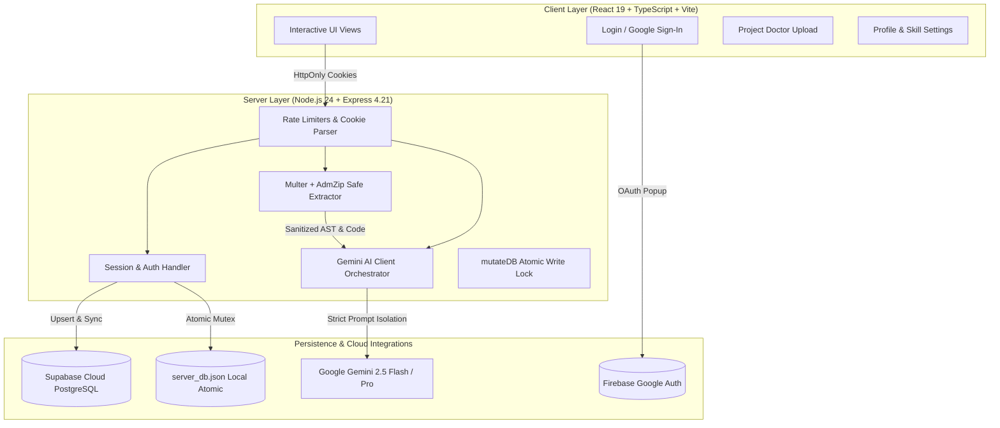

<div align="center">

# 🚀 Projevo AI

### **AI-Powered Engineering Project Mentor & Development Ecosystem**

*Accelerating engineering students from initial ideation to academic viva & technical interview defense.*

---

[](https://react.dev/)
[](https://www.typescriptlang.org/)
[](https://nodejs.org/)
[](https://expressjs.com/)
[](https://vitejs.dev/)
[](https://ai.google.dev/)
[](https://vitest.dev/)
[](https://github.com/CMonika67/Projevo-AI)
[](LICENSE)

<br />

<p align="center">
  <a href="#-key-features"><b>Explore Features</b></a> •
  <a href="#-architecture--workflow"><b>Architecture</b></a> •
  <a href="#-quick-start"><b>Quick Start</b></a> •
  <a href="#-security--hardening"><b>Security</b></a> •
  <a href="#-automated-testing"><b>Testing</b></a> •
  <a href="#-tech-stack"><b>Tech Stack</b></a>
</p>

</div>

---

## 📖 Overview

**Projevo AI** is an intelligent, full-stack mentor designed specifically for engineering undergraduates and developers. Most existing tools solve only isolated steps of development — like syntax highlighting or generic LLM chat. 

Projevo AI bridges the entire lifecycle: helping students discover tailored project ideas, diagnose multi-file codebases, receive adaptive learning hints, and rehearse rigorous viva questions and technical architectural defense before university faculty or industry recruiters.

```
┌──────────────┐     ┌──────────────┐     ┌──────────────┐     ┌──────────────┐
│  Understand  │ ──> │   Analyze    │ ──> │   Diagnose   │ ──> │    Defend    │
│    Skills    │     │  Feasibility │     │  Code Health │     │  Viva & Prep │
└──────────────┘     └──────────────┘     └──────────────┘     └──────────────┘
```

---

## ✨ Key Features

### 🩺 1. Project Doctor (AI Code Diagnostics)
- **Multi-File & Archive Inspection**: Upload `.zip`, `.py`, `.js`, `.ts`, `.tsx`, `.json`, or `.txt` projects.
- **Deep Code Health Scoring**: Generates categorical health scores across **Architecture**, **Code Quality**, **Security**, **Performance**, and **Accessibility**.
- **Issue Detection & Remediation**: Pinpoints exact files, line numbers, issue descriptions, and actionable code fixes.
- **Enterprise-Grade Zip Slip Protection**: Path-sanitizing unzipper rejects symlinks, directory traversal attacks, and files exceeding strict resource limits.

### 💡 2. Idea Analyzer & Feasibility Engine
- **Viability Assessment**: Evaluates proposed project concepts against real-world engineering standards.
- **Prerequisite Gap Analysis**: Compares project requirements directly against the student's current skill profile.
- **Recommended Tech Stack**: Outlines optimal frameworks, databases, libraries, and deployment strategies.

### 🧠 3. Adaptive Learning & Contextual Support
- **Step-by-Step Scaffolding**: Offers graded hints that guide students toward solutions without simply giving away answers.
- **Tailored Explanations**: Contextualized using the student's known strengths and declared target career domains.

### 🎯 4. Viva & Technical Interview Simulator
- **Rigorous Question Generation**: Produces challenging viva questions based on the student's actual codebase and architectural decisions.
- **Multi-Angle Coverage**: Drills on algorithmic choices, failure modes, scalability limits, database normalization, and security trade-offs.
- **Expected Answers & Key Points**: Clear rubrics to assist students in mastering technical articulation.

### 👤 5. Student Profile & Dynamic Skill Matrix
- **Customizable Skill Matrix**: Visual sliders to track progress in languages, frameworks, and methodologies.
- **Smart Avatar Engine**: Generates Google-style deterministic monogram avatars when no custom photo is uploaded.
- **Verified GitHub Integration**: Optional GitHub connection displaying active developer credentials.

### 🔐 6. Hardened Security by Design
- **Secure Authentication**: HttpOnly, SameSite, and conditionally Secure session cookies prevent XSS credential theft.
- **Rate-Limited Endpoints**: Protects `/api/auth/login`, `/api/auth/register`, and `/api/auth/forgot-password` against brute-force attacks.
- **Prompt Injection Sandboxing**: Encapsulates untrusted student code in `<untrusted_student_code>` XML tags with strict system instructions for the LLM.
- **Zero-Vulnerability Baseline**: Transitive dependency pinning (`@grpc/grpc-js`) ensures `0` vulnerabilities in `npm audit`.

---

## 🏛 Architecture & Workflow



---

## 🛠 Tech Stack

| Domain | Technology | Purpose |
| :--- | :--- | :--- |
| **Frontend** | [React 19](https://react.dev/) | Modern concurrent UI architecture |
| | [TypeScript 5.8](https://www.typescriptlang.org/) | Strict end-to-end type safety |
| | [Vite 6.4](https://vitejs.dev/) | Lightning-fast HMR and optimized production bundling |
| | [Tailwind CSS](https://tailwindcss.com/) | Responsive, utility-first UI styling |
| | [Lucide React](https://lucide.dev/) | Accessible, consistent iconography |
| **Backend** | [Node.js 24](https://nodejs.org/) | Modern server-side runtime |
| | [Express 4.21](https://expressjs.com/) | RESTful API server and routing engine |
| | [Multer](https://github.com/expressjs/multer) | Safe streaming multipart/form-data upload handling |
| | [AdmZip](https://github.com/cthackers/adm-zip) | Archive extraction with custom traversal safeguards |
| | [bcryptjs](https://github.com/dcodeIO/bcrypt.js) | Salted password hashing (cost factor 10) |
| | [express-rate-limit](https://github.com/express-rate-limit/express-rate-limit) | Tiered DoS and brute-force mitigation |
| **AI Engine** | [Google Gemini](https://ai.google.dev/) | Code diagnostics, recommendation generation, viva questions |
| **Persistence** | [Local Atomic JSON](https://nodejs.org/) | Resilient zero-config local development database |
| | [Supabase (PostgreSQL)](https://supabase.com/) | Multi-tenant cloud persistence & optional real-time sync |
| | [Firebase](https://firebase.google.com/) | One-click Google Sign-In authentication |
| **Quality** | [Vitest 4.1](https://vitest.dev/) | Comprehensive unit, integration, and security test suite |
| | [Supertest](https://github.com/ladjs/supertest) | HTTP assertion library for endpoint verification |

---

## 🚀 Quick Start

### 1. Prerequisites
- **Node.js**: v18.0.0 or later (v20+ / v24 recommended)
- **npm**: v9.0.0 or later
- **Git**

### 2. Clone Repository
```bash
git clone https://github.com/CMonika67/Projevo-AI.git
cd Projevo-AI
```

### 3. Install Dependencies
```bash
npm install
```

### 4. Configure Environment Variables
Copy the template configuration file:
```bash
cp .env.example .env
```

Open `.env` and fill in your keys:
```env
# Gemini AI (Required for diagnostics & mentors)
GEMINI_API_KEY=your_gemini_api_key_here
APP_URL=http://localhost:3000

# Optional: Supabase Cloud Database
NEXT_PUBLIC_SUPABASE_URL=https://your-project.supabase.co
NEXT_PUBLIC_SUPABASE_PUBLISHABLE_KEY=your-publishable-key
SUPABASE_URL=https://your-project.supabase.co
SUPABASE_ANON_KEY=your-publishable-key

# Optional: Firebase Authentication (Google Sign-In)
VITE_FIREBASE_API_KEY=your-firebase-api-key
VITE_FIREBASE_AUTH_DOMAIN=your-app.firebaseapp.com
VITE_FIREBASE_PROJECT_ID=your-project-id
VITE_FIREBASE_STORAGE_BUCKET=your-app.firebasestorage.app
VITE_FIREBASE_MESSAGING_SENDER_ID=your-sender-id
VITE_FIREBASE_APP_ID=your-app-id
```

### 5. Launch Development Server
```bash
npm run dev
```
> [!NOTE]
> The server automatically frees orphan processes on port `3000` and serves the Vite client and Express API on `http://localhost:3000`.

---

## 🧪 Automated Testing

Projevo AI features an automated test suite with **62 test cases** covering functionality, security defenses, authentication mechanisms, and edge cases.

```bash
# Run Vitest test suite
npm test

# Run tests in watch mode
npm run test:watch

# Run TypeScript type check
npm run lint
```

### Test Coverage Highlights
- ✅ **Authentication**: Registration, Login, HttpOnly Cookie delivery, Session expiry, Invalidation on logout.
- ✅ **Password Security**: SHA-256 reset code hashes, single-use enforcement, attempt exhaustion, brute-force rate limiters.
- ✅ **Project Doctor**: Upload validation, Zip Slip directory traversal defense, oversized file rejection, corrupted zip recovery.
- ✅ **Prompt Injection**: LLM prompt isolation validation, untrusted tag encapsulation.
- ✅ **Database Mutex**: High-concurrency race condition prevention, automated corrupted file preservation.
- ✅ **Information Disclosure**: Verifies stack traces, internal server paths, and API keys are never exposed in error responses.

---

## 🔒 Security Hardening

| Threat | Mitigation Mechanism | Implementation |
| :--- | :--- | :--- |
| **XSS Token Theft** | Secure Cookies | Sessions use `HttpOnly`, `SameSite: Lax`, and conditionally `Secure` cookies. Zero tokens in `localStorage`. |
| **Brute Force / DoS** | `express-rate-limit` | Tiered IP limiting on login (5/15m), register (10/h), and reset code requests (3/15m). |
| **Zip Slip Traversal** | Canonical Path Guard | AdmZip extractor validates each normalized file path against the target directory; rejects symlinks. |
| **LLM Prompt Injection** | Tagged XML Isolation | Uploaded code is quarantined inside `<untrusted_student_code>` blocks with explicit system boundaries. |
| **Credential Leakage** | History & Code Sanitization | All API keys are loaded via `.env` (gitignored). Zero hardcoded fallback keys in source files or git history. |
| **Error Fingerprinting** | Sanitized Handlers | Production error middleware strips system paths, internal stack traces, and database schemas. |

---

## 📁 Repository Structure

```text
Projevo-AI/
├── api/
│   └── index.ts                 # Vercel serverless function entrypoint
├── scripts/
│   └── migrate_to_supabase.ts   # CLI script for local DB to Supabase migration
├── src/
│   ├── components/
│   │   ├── AdaptiveSupportView.tsx   # Contextual hints and step-by-step guidance
│   │   ├── IdeaAnalyzerModal.tsx     # Feasibility analysis and tech stack recommender
│   │   ├── InterviewPrepView.tsx     # Technical viva simulator and defense rehearsal
│   │   ├── LoginView.tsx             # Auth modal (Email/Password + Google OAuth)
│   │   ├── Navigation.tsx            # Topbar navigation with active status indicators
│   │   ├── ProfileSettingsView.tsx   # Profile details, skill matrix, and GitHub link
│   │   ├── ProjectDoctorView.tsx     # Code analysis, health scores, and issue remedies
│   │   └── UserAvatar.tsx            # Deterministic initial letter avatar component
│   ├── api.ts                   # Robust fetch wrapper with credentials and error handling
│   ├── firebase.ts              # Firebase client SDK initialization & Google OAuth
│   ├── supabase.ts              # Supabase client and sync persistence helpers
│   ├── types.ts                 # Shared TypeScript interfaces and domain models
│   ├── App.tsx                  # Root React application container and state
│   └── index.css                # Global styles and Tailwind directives
├── .env.example                 # Environment configuration template
├── package.json                 # Project dependencies, scripts, and overrides
├── server.ts                    # Hardened Express server and Gemini orchestrator
├── server.test.ts               # 62 automated Vitest test specifications
├── supabase_schema.sql          # Cloud PostgreSQL schema, RLS policies, and triggers
├── vite.config.ts               # Vite bundler configuration
└── vitest.config.ts             # Vitest test runner configuration
```

---

## 📦 Building for Production

To create an optimized production build:

```bash
npm run build
```

This compiles:
1. The Vite client into `dist/` (minified HTML, CSS, and JS chunks).
2. The Node.js server into `dist/server.cjs` via `esbuild`.

To start the compiled production server:
```bash
NODE_ENV=production node dist/server.cjs
```

---

## 📄 License

This project is licensed under the **MIT License**. Feel free to use, modify, and distribute it for academic and professional purposes.

---

<div align="center">
  <sub>Built with ❤️ for engineering students and aspiring software professionals.</sub>
</div>
