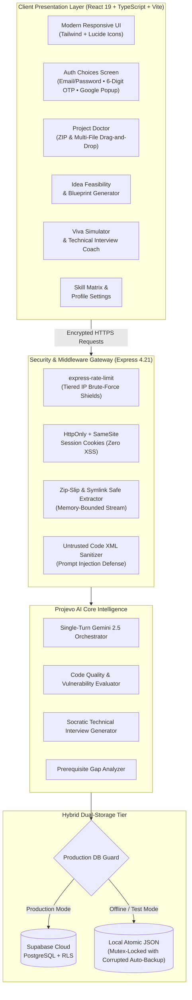

<div align="center">

# 🚀 Projevo AI

### **The Intelligent Engineering Project Co-Pilot & Technical Defense Ecosystem**

*From initial architectural ideation to production-grade code diagnostics, skill roadmap mastery, and rigorous viva/interview defense.*

---

[](https://react.dev/)
[](https://www.typescriptlang.org/)
[](https://nodejs.org/)
[](https://expressjs.com/)
[](https://vitejs.dev/)
[](https://ai.google.dev/)
[](https://supabase.com/)
[](https://vitest.dev/)
[](https://github.com/CMonika67/Projevo-AI)
[](LICENSE)

<br />

<p align="center">
  <a href="#-the-uniqueness-of-projevo-ai"><b>Why Projevo AI?</b></a> •
  <a href="#-core-pillars--feature-tour"><b>Core Pillars</b></a> •
  <a href="#-architecture--data-flow"><b>Architecture</b></a> •
  <a href="#-competitive-matrix"><b>Uniqueness Matrix</b></a> •
  <a href="#-tech-stack"><b>Tech Stack</b></a> •
  <a href="#-quick-start"><b>Quick Start</b></a> •
  <a href="#-automated-testing--verification"><b>Testing (175 Tests)</b></a> •
  <a href="#-enterprise-grade-security"><b>Security</b></a>
</p>

</div>

---

## 🌟 The Uniqueness of Projevo AI

Most developer tools solve isolated problems: **ChatGPT** produces generic text without repo context; **GitHub Copilot** autocompletes lines without evaluating architectural trade-offs; **LeetCode** focuses on abstract puzzles rather than full-stack system design; and static linters flag typos without providing interview-ready justifications.

**Projevo AI is built differently.** It is the first end-to-end engineering career co-pilot specifically engineered for student builders, capstone teams, and technical interview candidates:

1. **Full-Lifecycle Engineering Co-Pilot**: Guides builders from raw concept feasibility, prerequisite skill gap analysis, and system blueprints to live code auditing and final viva defense.
2. **Context-Aware Code Diagnostics (Project Doctor)**: Quarantines, scans, and scores entire multi-file project archives (`.zip`, `.py`, `.ts`, `.tsx`, `.js`) across 6 architectural dimensions with actionable remediation patches.
3. **Viva & Technical Defense Rehearsal**: Simulates rigorous university faculty vivas and Big-Tech architecture interrogations based on the user's *actual codebase* and design choices.
4. **Zero-Latency Single-Turn AI Engine**: Optimized prompt orchestration eliminates slow chained requests, delivering structured feasibility blueprints and interview question batches in a single high-speed Gemini roundtrip.
5. **Resilient Dual-Engine Persistence**: Seamlessly operates in zero-config offline mode (ACID-guaranteed local atomic store) and connects natively to cloud **Supabase PostgreSQL with Row-Level Security** in production.

---

## 🏛 Architecture & Data Flow



---

## 🎯 Core Pillars & Feature Tour

### 🩺 1. Project Doctor — AI Code Diagnostics & Security Audit
- **Deep Multi-File Analysis**: Drop an entire project `.zip` or individual source files. Project Doctor scans the tree, infers the tech stack automatically, and evaluates architecture.
- **6-Dimensional Health Scoring**:
  - 🏗️ **Architecture & Separation of Concerns**
  - 🧹 **Code Quality & Maintainability**
  - 🛡️ **Security Vulnerabilities & Secrets Exposure**
  - 🔒 **Brute-Force & Rate-Limiting Defenses**
  - ♿ **Accessibility & Web Standards Compliance**
  - ⚡ **Asynchronous Execution & Performance Traps**
- **Actionable Remediation**: Every identified defect includes the exact file path, line number, issue explanation, and ready-to-apply diff patch.

### 💡 2. Idea Analyzer & Architectural Blueprinting
- **Feasibility Assessment**: Evaluates project ideas against real-world technical complexity, scalability, and time constraints.
- **System Architecture Blueprint**: Generates data models, component hierarchies, recommended technology stacks (frontend, backend, database, deployment), and potential architectural failure modes.
- **Prerequisite Gap Detection**: Compares project requirements against your declared skills to pinpoint exactly what technologies you need to master before building.

### 🎤 3. Viva & Technical Interview Simulator
- **Codebase-Grounded Interrogation**: Generates deep conceptual and architectural viva questions tailored specifically to your active project.
- **Multi-Difficulty Batches**: Drills on algorithmic choices, failure modes, scalability limits, database indexing, and trade-offs between speed and consistency.
- **Evaluation Criteria & Answer Rubrics**: Provides model answers, expected terminology, and technical justification rubrics to help engineers articulate their technical decisions with confidence.

### 📊 4. Dynamic Skill Matrix & Career Pathways
- **Self-Calibrating Proficiency Sliders**: Track progress across languages, frameworks, cloud tools, and engineering methodologies.
- **Personalized Learning Milestones**: Interactive checklists and milestone trackers keep you on target from initial setup to deployment.
- **Verified GitHub Integration**: Showcases your GitHub profile handle, tracked projects, and academic credentials.

### 🔐 5. Zero-Trust Security & Enterprise Resilience
- **Strict Row-Level Isolation (Anti-IDOR)**: Enforces total horizontal privilege separation — users can never inspect, modify, or leak each other's project data or diagnostics.
- **Resilient Email OTP Delivery**: Native 6-digit numeric verification codes sent via Resend custom SMTP — completely eliminating spam redirects and broken sign-in links.
- **Prompt Injection Quarantine**: Wraps all untrusted student code inside `<untrusted_student_code>` boundary tags with strict adversarial directive blocking.
- **Zero Secret Leakage**: Sanitized global error handlers ensure stack traces, server paths, and API keys are never leaked to clients.

---

## 🥊 Competitive Matrix

| Capability | Generic LLM Chat (ChatGPT) | GitHub Copilot | LeetCode / HackerRank | **Projevo AI** |
| :--- | :---: | :---: | :---: | :---: |
| **Full Project Architecture Feasibility** | ⚠️ Generic advice | ❌ No | ❌ No | **✅ Deep blueprinting & tech stack engine** |
| **Archive Codebase Audit (`.zip`)** | ❌ Text only | ❌ Editor only | ❌ No | **✅ Multi-file AST & code health scoring** |
| **Security & Vulnerability Scanning** | ⚠️ Surface level | ⚠️ Basic warnings | ❌ No | **✅ 6-dimension audit with line-by-line diffs** |
| **Personalized Skill Gap Analysis** | ❌ No | ❌ No | ❌ No | **✅ Direct comparison of skills vs project needs** |
| **Viva & Architectural Defense Simulator** | ⚠️ Unstructured | ❌ No | ❌ Algorithm only | **✅ Tailored viva defense rubrics & questions** |
| **Zero-Setup Local & Cloud Dual Mode** | ❌ Cloud only | ❌ Cloud only | ❌ Cloud only | **✅ Local ACID JSON + Supabase Cloud PostgreSQL** |
| **Prompt Injection Sandboxing** | ❌ Vulnerable | N/A | N/A | **✅ Isolated XML quarantine boundaries** |

---

## 🛠 Tech Stack

### Frontend Architecture
- **Framework**: [React 19](https://react.dev/) — High-performance concurrent UI with functional components and modern hooks.
- **Language**: [TypeScript 5.8](https://www.typescriptlang.org/) — Strict end-to-end type safety with shared interfaces.
- **Build Engine**: [Vite 6.4](https://vitejs.dev/) — Sub-second Hot Module Replacement (HMR) and optimized Rollup tree-shaking.
- **Styling**: [Tailwind CSS](https://tailwindcss.com/) — Clean, utility-first responsive design with accessible color contrast.
- **Icons**: [Lucide React](https://lucide.dev/) — Crisp, accessible SVG iconography.

### Backend & Cloud Services
- **Runtime**: [Node.js 24 LTS](https://nodejs.org/) — Fast server-side asynchronous execution.
- **API Framework**: [Express 4.21](https://expressjs.com/) — RESTful routing engine with centralized error mitigation.
- **AI Core**: [Google Gemini 2.5 Flash / Pro](https://ai.google.dev/) — Low-latency structured JSON generation and code analysis.
- **Cloud Database**: [Supabase PostgreSQL](https://supabase.com/) — Managed relational database with connection pooling and RLS.
- **Local Persistence**: **Atomic Mutex JSON Engine** — Zero-config offline development store with automated corrupted-file recovery.
- **Email Delivery**: **Resend SMTP Integration** — Reliable transactional delivery for 6-digit verification codes.
- **Authentication**: **Hybrid Auth Engine** (Supabase Auth + Firebase Google OAuth Popup + Local Bcrypt).

---

## 🚀 Quick Start Guide

### 1. Prerequisites
- **Node.js**: `v18.0.0` or later (`v20+` or `v24` recommended)
- **npm**: `v9.0.0` or later
- **Git**

### 2. Clone & Install
```bash
# Clone the repository
git clone https://github.com/CMonika67/Projevo-AI.git
cd Projevo-AI

# Install all dependencies (with pinned security tree)
npm install
```

### 3. Configure Environment Variables
Copy the example environment configuration:
```bash
cp .env.example .env
```

Open `.env` and configure your credentials:
```env
# Required: Google Gemini AI API Key
GEMINI_API_KEY=your_gemini_api_key_here
APP_URL=http://localhost:3000

# Optional: Supabase Cloud Database & Authentication
NEXT_PUBLIC_SUPABASE_URL=https://your-project.supabase.co
NEXT_PUBLIC_SUPABASE_PUBLISHABLE_KEY=your-publishable-key
SUPABASE_URL=https://your-project.supabase.co
SUPABASE_ANON_KEY=your-publishable-key
SUPABASE_SERVICE_ROLE_KEY=your-service-role-key

# Optional: Firebase Authentication (for one-click Google popup)
VITE_FIREBASE_API_KEY=your-firebase-api-key
VITE_FIREBASE_PROJECT_ID=your-firebase-project-id
```

### 4. Run Locally
```bash
# Start backend server & Vite client concurrently on port 3000
npm run dev
```

Visit **[http://localhost:3000](http://localhost:3000)** in your browser.

---

## 🧪 Automated Testing & Verification

Projevo AI maintains an exhaustive automated test suite with **175 test cases** across 6 comprehensive suites:

```bash
# Run the complete test suite
npm test

# Run tests in watch mode
npm run test:watch

# Verify TypeScript type integrity
npm run lint

# Compile production bundles (Vite + esbuild)
npm run build
```

### Test Suite Breakdown
| Suite | Tests | Scope |
| :--- | :---: | :--- |
| `server.test.ts` | **67** | Comprehensive regression, password hash storage, rate limits, Zip Slip, diagnostic health. |
| `db_persistence.test.ts` | **34** | Multi-user isolation, milestone state synchronization, session invalidation, and data integrity. |
| `auth_and_health_comprehensive.test.ts` | **28** | Supabase OAuth fallback, Magic Link exchange, session renewal, and production health guards. |
| `new_features.test.ts` | **18** | Profile persistence, clean initial states, project discovery, and milestone tracking. |
| `e2e_verification.test.ts` | **14** | Complete user lifecycle from registration, diagnostic upload, to interview simulator. |
| `master_prompt_verification.test.ts` | **14** | End-to-end functional acceptance across all 14 master specification scenarios. |
| **Total** | **175** | **100% Passing** |

---

## 🔒 Enterprise-Grade Security

| Threat Vector | Mitigation Strategy | Technical Implementation |
| :--- | :--- | :--- |
| **Session Hijacking / XSS** | Secure Cookie Isolation | Sessions use `HttpOnly`, `SameSite: Lax`, and conditionally `Secure` cookies. No JWTs stored in `localStorage`. |
| **Brute Force & Credential Stuffing** | `express-rate-limit` | Tiered IP limiting on login (5 req/15m), registration (10 req/h), and reset requests (3 req/15m). |
| **Insecure Direct Object Reference (IDOR)** | User Context Verification | All API operations strictly bind mutations to the authenticated `context.userEmail` / `context.userId`. |
| **Zip Slip & Path Traversal** | Canonical Boundary Check | ZIP extraction resolves and verifies every entry against the root directory; blocks symlinks and absolute paths. |
| **Adversarial Prompt Injection** | Tagged XML Quarantine | Student code is encapsulated within `<untrusted_student_code>` blocks with explicit system negative prompts. |
| **Credential Leakage in Repos** | Environment Pinning | All API keys and secrets load via `.env` (strictly gitignored). Zero hardcoded fallback credentials. |
| **Information Disclosure** | Masked Error Handlers | Production errors return sanitized messages with all system stack traces and file paths stripped. |

---

## 📁 Repository Structure

```text
Projevo-AI/
├── api/
│   └── index.ts                 # Serverless entrypoint for cloud edge hosting (e.g., Vercel)
├── scripts/
│   └── migrate_to_supabase.ts   # Automated CLI tool for migrating local DB to Supabase Cloud
├── src/
│   ├── components/
│   │   ├── AdaptiveSupportView.tsx   # Contextual problem hints and step-by-step guidance
│   │   ├── IdeaAnalyzerModal.tsx     # Feasibility assessment, blueprints, and tech recommender
│   │   ├── InterviewPrepView.tsx     # Code-grounded viva simulator and interview rehearsal
│   │   ├── LoginView.tsx             # Auth modal (Email/Password, 6-Digit OTP, Google OAuth)
│   │   ├── Navigation.tsx            # Header navigation with active screen indicators
│   │   ├── ProfileSettingsView.tsx   # Profile details, skill matrix, and GitHub handle
│   │   ├── ProjectDoctorView.tsx     # Multi-file code diagnostics and health scoring
│   │   └── UserAvatar.tsx            # Deterministic initial letter avatar component
│   ├── api.ts                   # Type-safe client fetch wrapper with automated credentials
│   ├── firebase.ts              # Firebase Client SDK for optional Google popup auth
│   ├── supabase.ts              # Supabase Client SDK and cloud persistence synchronization
│   ├── types.ts                 # Shared domain data models and TypeScript types
│   ├── App.tsx                  # Root application controller and global state
│   └── index.css                # Tailwind CSS styling and global typography
├── .env.example                 # Environment configuration template
├── dbAdapter.ts                 # Unified PostgreSQL and local database abstraction layer
├── package.json                 # Pinned dependencies, scripts, and build configurations
├── server.ts                    # Hardened Express API server and Gemini orchestrator
├── server.test.ts               # Automated security and integration test suite
├── supabase_schema.sql          # Cloud PostgreSQL schema, RLS policies, and triggers
├── vite.config.ts               # Vite bundler configuration
└── vitest.config.ts             # Vitest test framework configuration
```

---

## 📦 Production Deployment

### Building the Distribution Bundle
```bash
npm run build
```
This runs Vite production compilation (`dist/`) and bundles the server into `dist/server.cjs` via `esbuild`.

### Running Production Server
```bash
NODE_ENV=production node dist/server.cjs
```

### Deploying to Vercel
1. Push the repository to GitHub.
2. Import the project into the [Vercel Dashboard](https://vercel.com/).
3. Add your environment variables (`GEMINI_API_KEY`, `SUPABASE_URL`, `SUPABASE_ANON_KEY`, etc.).
4. Click **Deploy** — the included `api/index.ts` automatically serves the serverless backend.

---

## 📄 License

This project is open-source and licensed under the **[MIT License](LICENSE)**. Feel free to use, adapt, and build upon it for academic and professional projects.

---

<div align="center">

**Built with passion to empower the next generation of software engineers.**

<sub>If you find Projevo AI useful, consider giving this repository a ⭐ on GitHub!</sub>

</div>
