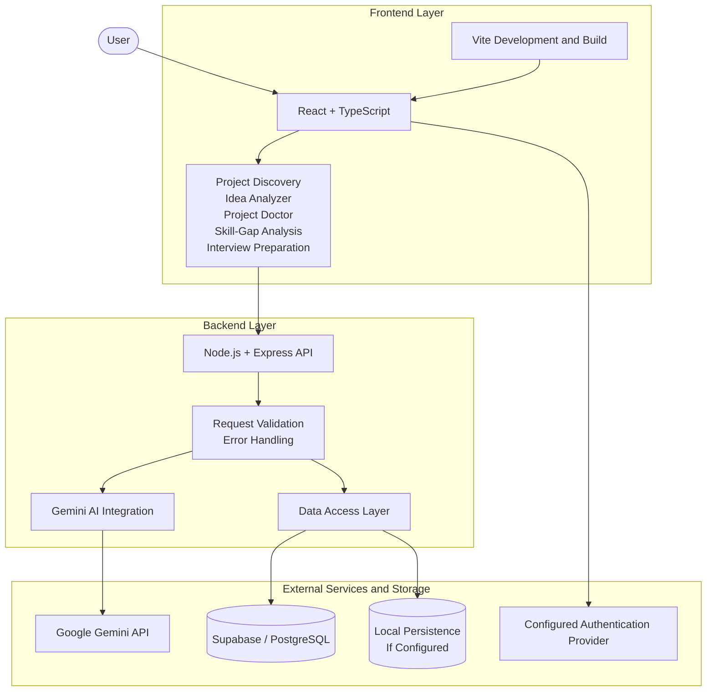
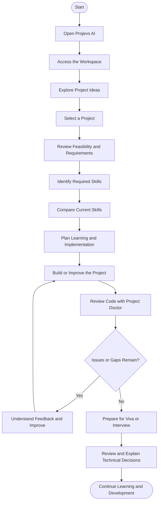
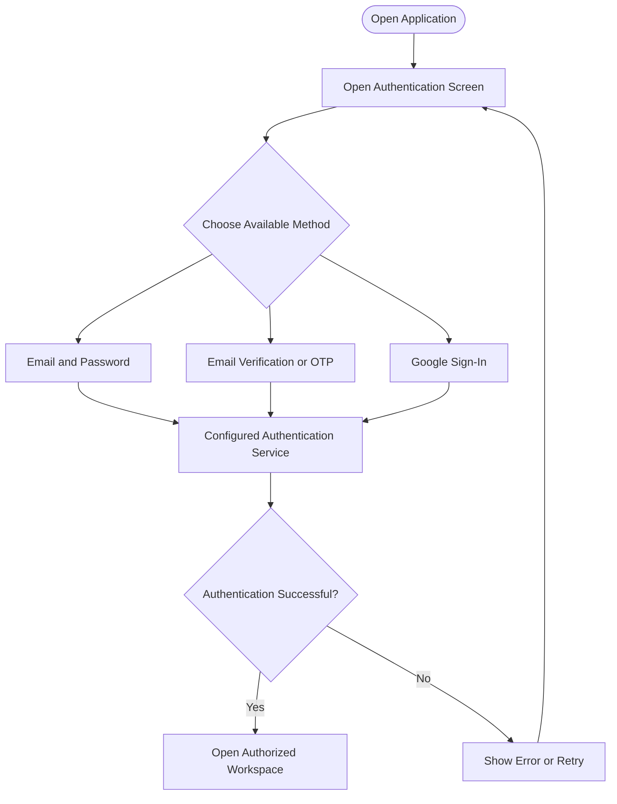
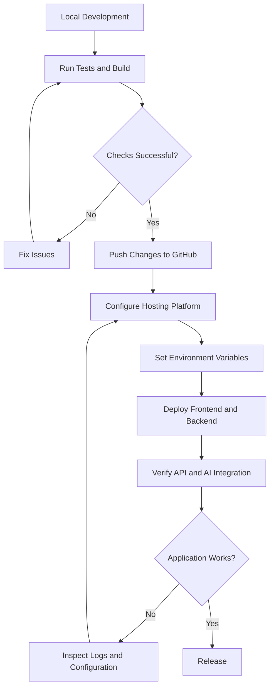

# 🚀 Projevo AI
### AI-Powered Engineering Project Co-Pilot

**From project idea to implementation, skill development, code analysis, and technical interview preparation.**

Projevo AI is an AI-assisted platform designed to help students and aspiring developers plan, build, understand, and evaluate software projects. It brings project discovery, idea analysis, skill-gap identification, code diagnostics, and viva or interview preparation into one workspace.

[](https://react.dev/)
[](https://www.typescriptlang.org/)
[](https://vite.dev/)
[](https://nodejs.org/)
[](https://expressjs.com/)
[](https://ai.google.dev/)
[](https://supabase.com/)

---

## 📑 Table of Contents

- [Overview](#-overview)
- [Problem Statement](#-problem-statement)
- [Project Objectives](#-project-objectives)
- [Key Features](#-key-features)
- [Application Screenshots](#-application-screenshots)
- [System Architecture](#-system-architecture)
- [Project Workflow](#-project-workflow)
- [Authentication Workflow](#-authentication-workflow)
- [Technology Stack](#-technology-stack)
- [Repository Structure](#-repository-structure)
- [Getting Started](#-getting-started)
- [Environment Configuration](#-environment-configuration)
- [Running the Application](#-running-the-application)
- [Testing and Build](#-testing-and-build)
- [Deployment](#-deployment)
- [Security Considerations](#-security-considerations)
- [Future Enhancements](#-future-enhancements)
- [Contributing](#-contributing)
- [License](#-license)

---

## 🌟 Overview

Building a software project involves more than writing code. Developers must choose a feasible idea, identify the required skills, design an appropriate architecture, debug implementation issues, and explain their technical decisions.

These activities are often handled using separate tools, making it difficult to maintain a clear view of the entire project journey.

**Projevo AI aims to connect these stages in a single project-focused workspace.**

It uses AI-assisted analysis to help users understand their project requirements, discover skill gaps, review code, and prepare to explain their work.

### 🎯 What makes Projevo AI useful?

- **Project-oriented guidance:** Organize project planning and development activities around the user's selected project.
- **Personalized skill development:** Compare existing skills with the skills required for a project.
- **Code understanding:** Analyze submitted code and surface potential issues and improvement opportunities.
- **Technical preparation:** Practice explaining project architecture, implementation choices, and technical concepts.
- **Connected workflow:** Move from project discovery to implementation and technical preparation in one application.

## ❗ Problem Statement

Students and early-career developers often face challenges when converting an idea into a working software project.

Common challenges include:

- Choosing a project that matches their interests, abilities, and available time.
- Identifying prerequisite technologies and missing skills.
- Understanding architectural and implementation issues.
- Finding practical ways to improve code quality and maintainability.
- Preparing to explain project decisions during a viva, presentation, or technical interview.
- Keeping project-related learning and progress organized.

Projevo AI addresses these challenges through an integrated, AI-assisted project development workflow.

## 🎯 Project Objectives

1. Help users explore and evaluate software project ideas.
2. Identify relevant technologies and prerequisite skills.
3. Compare existing skills with project requirements.
4. Assist users in reviewing code and understanding potential issues.
5. Support viva and technical interview preparation.
6. Provide a unified interface for project-related activities.
7. Encourage learning through actionable feedback and iterative improvement.

---

## ✨ Key Features

### 💡 1. Project Discovery and Idea Analyzer

Explore project possibilities and evaluate an idea before implementation.

**Key capabilities:**
- Discover ideas across supported domains and difficulty levels.
- Assess feasibility and technical complexity.
- Explore suggested technologies and project components.
- Understand potential implementation challenges.
- Use generated guidance to plan the next development steps.

### 🩺 2. Project Doctor — Code Analysis

Project Doctor helps users examine submitted source code and identify areas that may need attention.

**Key capabilities:**
- Submit supported source files or project archives, where enabled.
- Review code organization and maintainability.
- Identify potential implementation and security concerns.
- Understand reported issues through explanations and recommendations.
- Use the results to guide debugging and code improvement.

> AI-generated diagnostics are advisory. Review suggested changes and test them before applying them to a real project.

### 📊 3. Skill-Gap Analysis

Understand the difference between your current skills and the skills needed for your selected project.

**Key capabilities:**
- Record skills you already have.
- Identify skills required by a project.
- Highlight potential learning gaps.
- Organize learning priorities around project requirements.
- Support a more structured approach to learning new technologies.

### 🎤 4. Viva and Interview Preparation

Prepare to explain your project and defend your technical decisions.

**Key capabilities:**
- Practice project-related technical questions.
- Review important concepts and implementation choices.
- Prepare for questions about architecture, tools, and technologies.
- Improve the clarity of technical explanations.
- Use practice sessions to identify topics that need further revision.

### 👤 5. Profile and Skill Management

Maintain project-related profile information and organize your current skills.

**Key capabilities:**
- Manage profile details.
- Record and update skills.
- Support personalized project recommendations based on available profile information.
- Keep skill information connected to the project-planning workflow.

### 🔐 6. Authentication and Data Persistence

The application includes authentication and persistence integrations intended to support user access and application data.

Depending on the configured environment, these may include:
- Supabase and PostgreSQL integration.
- Firebase integration for Google authentication.
- Local persistence for development or testing.
- Email verification workflows, where configured.

The actual authentication and storage behavior depends on the active implementation and environment configuration.

---

## 🖼️ Application Screenshots

Screenshots make the project easier to understand during GitHub reviews, academic evaluations, and portfolio visits.

Add genuine screenshots from your running application to the `screenshots/` directory.

### 1. Login and Authentication


*Authentication interface for accessing Projevo AI.*

### 2. Main Dashboard


*The workspace for accessing project-related features.*

### 3. Project Discovery and Idea Analyzer


*Explore project ideas and examine their feasibility.*

### 4. Project Doctor


*Review submitted code and inspect diagnostic feedback.*

### 5. Skill-Gap Analysis


*Compare current skills with the skills required by a project.*

### 6. Interview Preparation


*Practice explaining technical concepts and project decisions.*

> **Important:** These paths are placeholders. Add the actual image files with the exact filenames shown above, or update the paths to match your screenshots. GitHub will not display an image that has not been added to the repository.

---

## 🏗️ System Architecture

The following diagram illustrates the intended high-level architecture of Projevo AI. The exact request paths and enabled services should match the current code and deployment configuration.



### Architecture overview

| Layer | Responsibility |
|---|---|
| Frontend | Displays the user interface and handles user interactions. |
| API layer | Receives application requests and coordinates backend operations. |
| AI integration | Sends supported analysis requests to the configured Gemini service. |
| Data access | Coordinates application data operations with the configured storage system. |
| Authentication | Supports the authentication provider enabled for the environment. |

**Architecture principle:** Keep user-interface logic, backend processing, AI integration, and data access organized into separate responsibilities wherever practical.

---

## 🔄 Project Workflow

The following flowchart describes the intended user journey through the application.



### Workflow explanation

1. **Explore:** Discover possible projects and select a suitable idea.
2. **Evaluate:** Understand the project's feasibility and technical requirements.
3. **Prepare:** Identify the skills needed before or during implementation.
4. **Build:** Develop the project and work through implementation challenges.
5. **Review:** Use code-analysis feedback to identify potential improvements.
6. **Prepare to present:** Practice explaining the project and its technical decisions.

This is a conceptual workflow; the features available at each step depend on the current application implementation.

---

## 🔑 Authentication Workflow



The diagram represents a conceptual flow. Email verification, OTP, Google sign-in, and session behavior must be confirmed against the authentication methods actually configured in your application.

---

## 🛠️ Technology Stack

| Technology | Purpose |
|---|---|
| React | Component-based frontend development |
| TypeScript | Type-safe application development |
| Vite | Development server and frontend build tooling |
| Tailwind CSS | Utility-based interface styling, if configured |
| Lucide React | Interface icons |
| Node.js | JavaScript runtime for the backend |
| Express | Backend API and routing |
| Google Gemini API | AI-assisted project and code analysis |
| Supabase | Cloud database and related services, if configured |
| PostgreSQL | Relational data storage through Supabase |
| Firebase | Google authentication integration, if configured |
| Vitest | Automated testing, if configured |

Refer to `package.json` and the environment configuration for the exact installed versions and available scripts.

---

## 📂 Repository Structure

The following structure reflects the main files described in the project documentation. Your actual repository may contain additional files or different paths.

```text
Projevo-AI/
├── api/
│   └── index.ts
├── scripts/
│   └── migrate_to_supabase.ts
├── src/
│   ├── components/
│   │   ├── AdaptiveSupportView.tsx
│   │   ├── IdeaAnalyzerModal.tsx
│   │   ├── InterviewPrepView.tsx
│   │   ├── LoginView.tsx
│   │   ├── Navigation.tsx
│   │   ├── ProfileSettingsView.tsx
│   │   ├── ProjectDoctorView.tsx
│   │   └── UserAvatar.tsx
│   ├── api.ts
│   ├── firebase.ts
│   ├── supabase.ts
│   ├── types.ts
│   ├── App.tsx
│   └── index.css
├── screenshots/
│   ├── login.png
│   ├── dashboard.png
│   ├── idea-analyzer.png
│   ├── project-doctor.png
│   ├── skill-gap.png
│   └── interview-preparation.png
├── .env.example
├── dbAdapter.ts
├── package.json
├── server.ts
├── server.test.ts
├── supabase_schema.sql
├── vite.config.ts
└── vitest.config.ts
```

### Important files

- `src/App.tsx` — Main frontend application component.
- `src/components/` — Feature-specific user-interface components.
- `src/api.ts` — Frontend API communication.
- `src/types.ts` — Shared TypeScript types.
- `server.ts` — Express backend entry point.
- `dbAdapter.ts` — Database access and persistence abstraction.
- `supabase_schema.sql` — Database schema, if used by the current setup.
- `api/index.ts` — Potential serverless entry point; deployment behavior depends on its implementation and hosting configuration.
- `package.json` — Dependencies and available project scripts.
- `server.test.ts` — Backend tests.

---

## 🚀 Getting Started

Follow these steps to run Projevo AI locally.

### Prerequisites

Install the following:

- [Node.js](https://nodejs.org/)
- npm, which is included with Node.js
- [Git](https://git-scm.com/)
- A Google Gemini API key for AI features
- Credentials for any optional cloud services you intend to use

Check your installed versions:

```bash
node --version
npm --version
git --version
```

Use a Node.js version compatible with the project's dependencies and deployment environment. Check `package.json` and any `engines` field for the supported version.

### Step 1: Clone the repository

```bash
git clone https://github.com/CMonika67/Projevo-AI.git
cd Projevo-AI
```

### Step 2: Install dependencies

```bash
npm install
```

### Step 3: Configure environment variables

Create your local environment file by copying the example file.

On macOS/Linux:

```bash
cp .env.example .env
```

On Windows PowerShell:

```powershell
Copy-Item .env.example .env
```

If `.env.example` does not exist, create `.env` using the variable names required by the current application code. Do not commit your actual `.env` file.

### Step 4: Add the required configuration

Open `.env` and configure the variables required by your application. The following are examples of variables documented for this project; the exact names must match the code.

```env
# AI service
GEMINI_API_KEY=your_gemini_api_key

# Application URL
APP_URL=http://localhost:3000

# Supabase - if cloud database features are enabled
SUPABASE_URL=https://your-project.supabase.co
SUPABASE_ANON_KEY=your-supabase-anon-key

# Browser-side Supabase configuration, if required
NEXT_PUBLIC_SUPABASE_URL=https://your-project.supabase.co
NEXT_PUBLIC_SUPABASE_PUBLISHABLE_KEY=your-supabase-publishable-key

# Firebase Google authentication - if enabled
VITE_FIREBASE_API_KEY=your-firebase-api-key
VITE_FIREBASE_PROJECT_ID=your-firebase-project-id
```

Some deployments may require additional variables, such as a service-role key, email-provider credentials, or server-side authentication settings.

**Configuration notes:**

- Never commit API keys, passwords, service-role keys, or other secrets.
- Keep privileged credentials on the server and never expose them through browser-side variables.
- Only add optional service configuration if the application actually uses that service.
- Verify environment-variable names against `server.ts`, `src/`, `.env.example`, and the deployment settings.
- A configured API key does not, by itself, guarantee that every feature is operational.

### Step 5: Start the application

```bash
npm run dev
```

If the development command starts both the frontend and backend, open the local URL shown in your terminal. If it uses a different port, follow the terminal output rather than assuming a fixed URL.

Open the application in your browser and verify that the required backend and AI services are available.

---

## 🧪 Testing and Build

Use the scripts defined in `package.json`.

### Run automated tests

```bash
npm test
```

### Run tests in watch mode

```bash
npm run test:watch
```

### Run the lint or type-check script

```bash
npm run lint
```

### Build for production

```bash
npm run build
```

Not every repository defines all four scripts. If a command is unavailable, inspect the `scripts` section of `package.json` and use the script actually provided.

### Recommended verification checklist

Before publishing a release, verify:

- [ ] The application starts without compilation errors.
- [ ] Login and logout work with the configured authentication provider.
- [ ] Profile and skill changes persist after refreshing the page.
- [ ] Project discovery displays the expected results.
- [ ] Skill-gap analysis returns meaningful output.
- [ ] Project Doctor handles supported files and invalid uploads appropriately.
- [ ] Interview preparation produces the expected results.
- [ ] Backend requests handle invalid input and service failures.
- [ ] The production build completes successfully.
- [ ] The deployed application uses the correct environment variables.

Only publish a test count or “all tests passing” badge after running the current test suite successfully. Test results can change as the code changes.

---

## ☁️ Deployment

Projevo AI can be deployed using a hosting platform compatible with its frontend and backend architecture.

### General deployment workflow



### Deployment checklist

1. Push the verified project code to GitHub.
2. Connect the repository to your selected hosting platform.
3. Configure the build command and output directory for the frontend.
4. Configure the backend entry point and supported runtime.
5. Add the required environment variables in the hosting dashboard.
6. Configure the database schema and authentication settings if required.
7. Set the correct application URL and authentication redirect URLs.
8. Deploy the application and inspect the deployment logs.
9. Test the deployed frontend, backend APIs, persistence, and AI features.

### Vercel deployment considerations

If deploying to Vercel, verify that the backend entry point is compatible with Vercel's serverless execution model. A conventional long-running Express server and a serverless function may require different configuration.

Also verify that:

- The build succeeds in the deployment environment.
- All required environment variables are configured for the correct deployment environments.
- Database connectivity works from the deployed backend.
- Persistent local filesystem storage is not relied upon for durable user data in a serverless environment.
- Authentication callback URLs and allowed domains match the deployed application.

A successful deployment build does not necessarily prove that all runtime features are working. Test the deployed application itself.

---

## 🔒 Security Considerations

Security is an ongoing engineering responsibility. Projevo AI should be evaluated against the following areas as its implementation evolves.

| Area | Recommended practice |
|---|---|
| API keys and secrets | Store secrets in environment variables or an appropriate secret manager. |
| Authentication | Validate sessions and enforce authorization on the backend. |
| User data isolation | Apply ownership checks to every user-specific read and write. |
| Database access | Use least-privilege credentials and appropriate Row-Level Security policies where applicable. |
| File uploads | Validate file types and sizes; safely handle archive paths and unexpected content. |
| AI-generated output | Treat model responses as untrusted input and validate structured results before use. |
| Error handling | Avoid returning secrets, stack traces, or internal infrastructure details to clients. |
| Rate limiting | Apply appropriate limits to sensitive endpoints and resource-intensive operations. |
| Dependency management | Keep dependencies updated and review known vulnerabilities. |
| Production configuration | Separate development and production credentials and settings. |

**Security note:** AI-assisted code review is not a substitute for dedicated security testing. Do not describe the application as vulnerability-free or fully secure without appropriate evidence and independent verification.

---

## 🔮 Future Enhancements

Potential improvements for future versions include:

- **Project progress tracking:** Track milestones and implementation progress for a selected project.
- **Improved project recommendations:** Refine recommendations using user interests, current skills, and project requirements.
- **Learning roadmaps:** Generate structured learning plans for identified skill gaps.
- **Richer diagnostics:** Improve code-analysis explanations and connect recommendations to specific source locations where supported.
- **Project documentation generation:** Help users organize architecture notes, implementation decisions, and project documentation.
- **Enhanced viva preparation:** Offer topic-based practice sessions and structured feedback.
- **Testing and quality reports:** Present test results and code-quality findings in a unified view.
- **Deployment guidance:** Help users identify configuration issues before deploying their projects.

These are potential future enhancements, not claims about currently implemented functionality.

---

## 🤝 Contributing

Contributions, suggestions, and bug reports are welcome.

To contribute:

1. Fork the repository.
2. Create a branch for your change.
3. Make your changes and add or update tests where appropriate.
4. Run the available test and build commands.
5. Commit your changes with a clear message.
6. Open a pull request describing the changes and any relevant testing.

For bugs, include steps to reproduce the issue, expected behavior, actual behavior, and relevant sanitized logs. Do not include API keys, passwords, or personal data.

---

## 📄 License

The project license should match the license file included in the repository.

If the repository contains an MIT `LICENSE` file, this section can read:

This project is licensed under the [MIT License](LICENSE).

If no license file exists, add the appropriate license before claiming that the project is MIT-licensed.

---

## 💙 Built for Student Developers

Projevo AI brings project planning, skill development, code analysis, and technical preparation together in one AI-assisted workspace.

**The goal is simple: help developers move from having an idea to understanding, building, improving, and confidently explaining their projects.**

If you find Projevo AI useful, consider starring the repository on GitHub.

**Repository:** [CMonika67/Projevo-AI](https://github.com/CMonika67/Projevo-AI)
