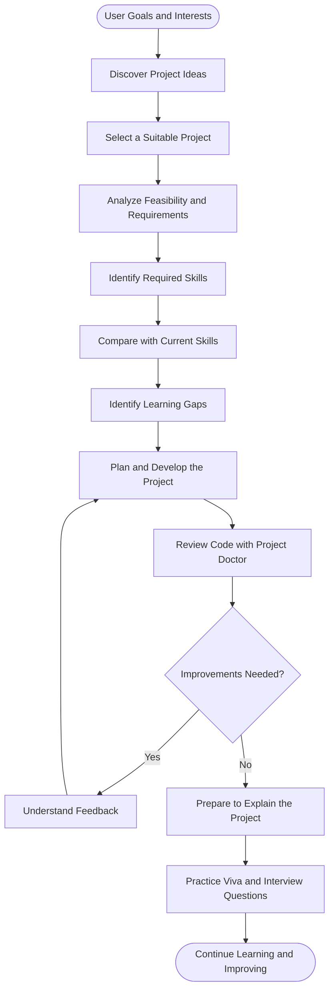
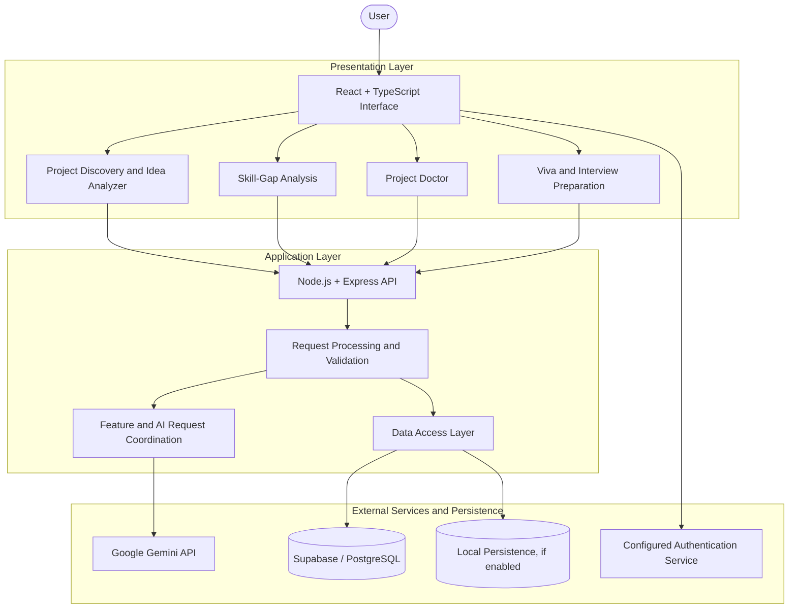

# 🚀 Projevo AI
### Your AI-Powered Engineering Project Co-Pilot

**Discover. Plan. Build. Analyze. Learn. Defend.**

Projevo AI is an AI-assisted software project development platform designed to help students and aspiring developers transform ideas into well-planned, skill-aligned, and technically understandable projects. It connects project discovery, feasibility analysis, skill-gap identification, code diagnostics, and viva or interview preparation in one unified workspace.

Rather than treating project development as simply writing code, Projevo AI focuses on the complete learning and development journey—from choosing a suitable project to understanding its implementation and confidently explaining its technical decisions.

---

## 📑 Contents

- [About Projevo AI](#-about-projevo-ai)
- [The Problem](#-the-problem)
- [Our Vision and Objectives](#-our-vision-and-objectives)
- [Core Features](#-core-features)
- [How Projevo AI Works](#-how-projevo-ai-works)
- [System Architecture](#-system-architecture)
- [Feature Workflow](#-feature-workflow)
- [Technology Stack](#-technology-stack)
- [Who Is It For?](#-who-is-it-for)
- [What Makes Projevo AI Different?](#-what-makes-projevo-ai-different)
- [Security and Responsible AI](#-security-and-responsible-ai)
- [Future Scope](#-future-scope)
- [Project Philosophy](#-project-philosophy)

---

## 🌟 About Projevo AI

Software projects are an important part of technical education and professional growth. However, building a successful project requires more than selecting a programming language or writing a few lines of code. Developers must understand the problem, evaluate the feasibility of a solution, identify the skills they need, choose suitable technologies, improve their implementation, and communicate their decisions effectively.

Projevo AI is designed to bring these activities together.

The platform provides an AI-assisted environment where users can explore project ideas, understand project requirements, identify learning gaps, analyze code, and prepare for technical discussions about their work.

### The central idea

**A developer should not only be able to build a project but also understand why it works, what can be improved, and how to explain the decisions behind it.**

Projevo AI aims to support that complete process through a connected, project-focused experience.

## ❗ The Problem

Students and aspiring developers frequently encounter several challenges during project development.

### 1. Choosing the right project

It can be difficult to find an idea that matches a person's interests, current abilities, academic requirements, and available time. An idea may sound impressive but be too complex to implement with the skills and resources available.

### 2. Understanding project feasibility

Before starting development, users need to understand the problem being solved, the proposed solution, the technologies involved, and the potential implementation challenges.

### 3. Identifying missing skills

Developers may know some of the technologies required for a project but lack experience in others. Without a clear comparison between current abilities and project requirements, learning can become unfocused.

### 4. Improving code quality

Finding implementation problems, understanding architectural weaknesses, and identifying potential security concerns can be challenging, especially for beginners working on multi-file projects.

### 5. Preparing to explain the project

Academic vivas, project demonstrations, and technical interviews require users to explain their architecture, technologies, implementation choices, limitations, and trade-offs—not merely demonstrate that the application runs.

### 6. Managing the complete development journey

Project planning, skill development, code review, and interview preparation are often performed using separate tools. This can make it harder to connect learning activities with the actual project being developed.

**Projevo AI addresses these challenges by organizing project-related guidance around a connected development and learning workflow.**

---

## 🎯 Our Vision and Objectives

### Vision

To help aspiring developers become more capable, independent, and technically confident builders by connecting project development with structured learning and deeper understanding.

### Objectives

- Help users discover relevant software project ideas.
- Support early evaluation of project feasibility and technical requirements.
- Connect project requirements with the skills needed to implement them.
- Help users identify and prioritize skill gaps.
- Provide AI-assisted feedback on submitted code.
- Encourage iterative improvement of project implementations.
- Support preparation for academic vivas and technical interviews.
- Make project-related learning and development more organized and understandable.

---

## ✨ Core Features

### 💡 1. Project Discovery and Idea Analyzer

**Turn an initial idea into a more structured project plan.**

Project Discovery and Idea Analyzer help users explore possible projects and understand what implementing an idea may involve.

Key capabilities include:

- **Idea exploration:** Discover project possibilities across supported domains and difficulty levels.
- **Feasibility assessment:** Examine the practical complexity and requirements of an idea.
- **Technology recommendations:** Explore technologies and tools relevant to the proposed solution.
- **Architecture planning:** Understand possible components and how they may fit together.
- **Challenge identification:** Consider potential implementation difficulties before development begins.
- **Planning support:** Use generated guidance to clarify the project's direction.

**Value:** Helps users make more informed project choices before investing significant time in implementation.

### 🩺 2. Project Doctor — AI-Assisted Code Analysis

**Understand potential problems in your code and identify opportunities to improve it.**

Project Doctor focuses on reviewing submitted source code and providing diagnostic feedback that can help developers understand their implementation.

Key capabilities include:

- **Code inspection:** Analyze supported source files and project archives where the feature is enabled.
- **Code organization review:** Examine structure and separation of responsibilities.
- **Maintainability feedback:** Highlight areas that may be difficult to understand or maintain.
- **Potential issue identification:** Surface possible implementation, performance, and security concerns.
- **Actionable explanations:** Explain findings and suggest ways to improve the code.
- **Iterative improvement:** Use feedback to guide debugging and further development.

**Value:** Helps developers move beyond simply finding that something is wrong to understanding what may need attention and why.

AI-generated findings are recommendations, not proof that a project is secure or free from defects. Suggestions should be reviewed and tested.

### 📊 3. Skill-Gap Analysis

**Understand what you know, what your project requires, and what you may need to learn next.**

Skill-Gap Analysis connects a user's current skills with the requirements of a selected project.

Key capabilities include:

- **Current skill tracking:** Record the technologies and skills a user already has.
- **Project skill identification:** Determine which skills may be needed for the selected project.
- **Gap identification:** Highlight differences between existing skills and project requirements.
- **Learning prioritization:** Help users identify areas that deserve attention.
- **Project-aligned learning:** Keep skill development connected to a practical implementation goal.

For example, a user planning a machine-learning web application may already know Python but need to learn API development, database integration, model deployment, or frontend fundamentals.

The precise gaps depend on the selected project and the skills recorded by the user.

**Value:** Encourages purposeful learning instead of studying technologies without a clear connection to a practical goal.

### 🎤 4. Viva and Technical Interview Preparation

**Prepare to explain not only what you built, but why you built it that way.**

The interview preparation feature supports practice around project-related concepts and technical decisions.

Key capabilities include:

- **Project-oriented questions:** Practice discussing the selected project's purpose and implementation.
- **Technical concept revision:** Review relevant programming and system concepts.
- **Architecture discussions:** Prepare to explain components, data flow, and technology choices.
- **Decision justification:** Practice discussing why a particular approach was chosen.
- **Limitations and trade-offs:** Prepare to discuss constraints, weaknesses, and possible improvements.
- **Learning through practice:** Identify topics that need further understanding or revision.

**Value:** Helps users develop the ability to communicate technical knowledge and explain their own implementation decisions more clearly.

### 👤 5. Profile and Skill Management

**Keep personal skill information connected to project planning.**

Profile and skill management provide a place to maintain relevant user information and track declared skills.

Key capabilities include:

- Managing profile details.
- Recording and updating current skills.
- Maintaining information used by personalized workflows, where supported.
- Connecting user skill information with project requirements.

**Value:** Provides a foundation for more relevant project guidance based on a user's declared experience and learning needs.

### 🔐 6. Authentication and Data Persistence

Projevo AI includes authentication and data-persistence integrations intended to support user access and application information.

Depending on the active configuration, the project may use:

- Supabase and PostgreSQL for cloud data storage.
- Firebase integration for Google authentication.
- Local persistence in supported development or testing configurations.
- Email verification workflows where configured.

The exact authentication methods, persistence guarantees, and access controls depend on the implemented configuration.

**Value:** Supports a more organized application experience in which user and project information can be managed through the platform.

---

## 🔄 How Projevo AI Works

Projevo AI is organized around the relationship between a user's goals, their current skills, their selected project, and the feedback they receive while developing it.

### The development journey

1. **Discover:** Explore possible projects and identify an idea worth pursuing.
2. **Evaluate:** Understand the problem, feasibility, and technical requirements.
3. **Prepare:** Identify the skills and technologies required for implementation.
4. **Learn:** Prioritize the skills that need improvement.
5. **Build:** Develop and refine the selected project.
6. **Analyze:** Review code and investigate potential issues.
7. **Explain:** Practice communicating the project's design and implementation decisions.
8. **Improve:** Use feedback to guide the next iteration.

This workflow describes the platform's intended project-development journey; individual steps depend on the features available in the current implementation.

---

## 🏗️ System Architecture

The following diagram illustrates a high-level conceptual architecture for Projevo AI, showing how its interface, backend, AI integration, authentication, and data services may interact.

### Architecture layers

| Layer | Role |
|---|---|
| Presentation layer | Provides the interface through which users interact with project features. |
| Application layer | Coordinates API requests and application operations. |
| AI integration | Connects supported features to the configured Gemini service. |
| Authentication | Handles user access through the configured authentication provider. |
| Data access | Coordinates data operations with the configured persistence layer. |

The diagram is a conceptual representation rather than a verified runtime trace. The actual service connections should be confirmed against the project's implementation.

---

## 🧠 What Makes Projevo AI Different?

Projevo AI is designed around **project-centered learning** rather than treating each development task as an unrelated activity.

| Development need | Projevo AI's intended contribution |
|---|---|
| Choosing a project | Helps users explore and evaluate project ideas. |
| Understanding requirements | Organizes feasibility and technology considerations. |
| Identifying skill gaps | Connects current skills with project requirements. |
| Improving implementation | Provides AI-assisted code diagnostics and recommendations. |
| Preparing for a viva | Supports practice around project-specific technical concepts. |
| Connecting learning to practice | Organizes these activities around a selected project. |

### The core distinction

Many development activities can be performed with individual tools. Projevo AI's focus is on bringing these activities into a connected workflow where project planning, skill development, code understanding, and technical preparation reinforce one another.

This is the platform's design goal, rather than a claim that other tools cannot provide similar capabilities.

---

## 🛠️ Technology Stack

The project documentation identifies the following technologies as part of the Projevo AI stack. The exact versions and active integrations depend on the current repository configuration.

| Technology | Role in the project |
|---|---|
| React | Building the user interface from reusable components. |
| TypeScript | Providing typed application code and shared data models. |
| Vite | Supporting frontend development and production builds. |
| Tailwind CSS | Utility-based styling, where configured. |
| Lucide React | Providing interface icons. |
| Node.js | Backend JavaScript runtime. |
| Express | API routing and backend request handling. |
| Google Gemini API | AI-assisted analysis and generated guidance. |
| Supabase | Cloud data and related services, where configured. |
| PostgreSQL | Relational database used through Supabase. |
| Firebase | Google authentication integration, where configured. |

---

## 👥 Who Is Projevo AI For?

### Students and academic project teams

Explore project ideas, understand requirements, identify skill gaps, and prepare to explain project work during academic reviews.

### Beginner developers

Connect learning goals to practical implementation and use diagnostic feedback to understand potential code improvements.

### Aspiring data scientists and AI developers

Organize project planning and learning around the technologies and skills required for AI-related projects.

### Final-year project teams

Use project-focused guidance to think through feasibility, implementation choices, code quality, and technical presentation.

### Technical interview candidates

Practice explaining project architecture, technologies, implementation choices, limitations, and trade-offs.

---

## 🔒 Security and Responsible AI

Projevo AI combines application functionality with AI-assisted analysis. Responsible implementation requires attention to both software security and the limitations of generated output.

Important considerations include:

- **Credential protection:** Keep private API keys and privileged credentials out of public repositories and browser-accessible code.
- **Authentication and authorization:** Verify user identity and enforce access permissions on protected backend operations.
- **Data isolation:** Ensure that user-specific information is accessed only by authorized users.
- **Safe file handling:** Validate uploaded content and handle unexpected or potentially malicious files carefully.
- **AI output validation:** Treat generated content as untrusted until it has been checked.
- **Human review:** Review proposed code changes and test them before adopting them.
- **Data transparency:** Explain how user information is stored and processed as the application evolves.

AI-assisted analysis can help identify potential issues, but it does not guarantee correctness, security, or completeness. Actual protections should be evaluated against the implemented system.

---

## 🔮 Future Scope

Projevo AI can evolve into a more comprehensive environment for project-centered learning and development.

Potential future enhancements include:

### 1. Personalized Learning Roadmaps
Create structured learning paths based on project requirements and identified skill gaps.

### 2. Project Progress Tracking
Connect project milestones, learning tasks, and implementation progress in one workspace.

### 3. Deeper Code Intelligence
Improve diagnostic explanations, code-context understanding, and traceability between findings and source locations.

### 4. Project Documentation Assistance
Help users organize architecture descriptions, design decisions, and project documentation.

### 5. Expanded Interview Practice
Introduce more structured practice sessions, topic-based evaluation, and feedback on technical explanations.

### 6. Project Quality Insights
Bring relevant code-quality, testing, and maintainability information into a more unified review experience.

### 7. Enhanced Personalization
Refine project suggestions using declared skills, interests, goals, and learning progress.

These are potential areas for future development, not assertions that the features are already implemented.

---

## 💙 Project Philosophy

Projevo AI is built around a simple idea:

**Building a project is only one part of becoming an engineer. Understanding the problem, learning what is needed, improving the solution, and explaining technical decisions are equally important.**

By connecting these activities, Projevo AI aims to make project development a more structured, understandable, and learning-oriented experience.

The goal is not simply to help users produce more code. It is to help them become more capable of planning, building, evaluating, and confidently explaining the software they create.

---

**Projevo AI — From ideas to implementation, and from implementation to understanding.**
